# Tianheng AI Weather Impact

Tianheng is a location-first weather-impact intelligence system for urban heavy-rain and flood-risk decisions. It turns weather context, terrain susceptibility, critical facilities, and response constraints into an auditable risk-to-action workflow.

The repository is a research and competition package. The public repository intentionally contains the backend and research materials; the Streamlit frontend is kept out of the GitHub release.

## What the system is designed to answer

- Which part of a city is likely to be affected next?
- Which roads, hospitals, schools, or other facilities should be checked first?
- What is the severe-weather probability and uncertainty range?
- How does the recommended action change when response starts earlier or resources are limited?

## Architecture

```mermaid
flowchart LR
  A[Weather, radar, DEM, GIS and event data] --> B[Adapters and data contracts]
  B --> C[Quality checks and provenance]
  C --> D[Terrain and spatiotemporal features]
  D --> E[Risk model and nowcast]
  E --> F[Uncertainty calibration]
  F --> G[Impact field and critical assets]
  G --> H[Drainage and counterfactual simulation]
  H --> I[Constrained action planning]
  I --> J[Local visual cockpit and evidence report]
```



The codebase keeps data, model, decision, provenance, and presentation layers separate. Every result can carry a run identifier, data version, model version, rule version, timestamp, and label-quality marker.

## Technical highlights

- Location-first Agent workflow with geocoding, live weather context, cache fallback, and provenance.
- Spatial risk field with critical-asset prioritisation instead of raw weather tables.
- Spatiotemporal forecasting interface for 30/60/120-minute ensemble horizons and uncertainty bands.
- Terrain-derived susceptibility features including slope, flow accumulation, depression depth, impervious surface, and distance to water.
- Urban drainage screening and counterfactual comparisons for earlier response, rainfall changes, resource limits, and road closures.
- Constraint-aware action planning with transparent reasons and evidence records.
- Provider-bound realtime Agent with live Open-Meteo context, deterministic offline fallback, and provenance flags.
- Four-dimensional radar voxel contract `(time, height, y, x)` with convective-core summaries and advection nowcast.
- Urban drainage digital twin baseline with storage, overflow, flooded-area indicators, and counterfactual interventions.
- A serializable backend service that composes weather, radar and drainage evidence for a private client.
- Authorized CMA radar adapter with JSON/NPY/NPZ parsing, download-envelope support, cache age limits, and provenance.
- Changchun drainage adapter for authorized CSV/JSON/GeoJSON exports with Chinese field mapping and explicit depth units.
- Source-aware runtime response that separates live, cached, synthetic, and unavailable data.
- Event-level evaluation protocol that avoids random time-slice leakage.
- Offline deterministic data path so the research workflow remains reproducible without network access.

## Research protocol

Experiments should split complete storm events into fit, calibration, and held-out test groups. Report MAE, RMSE, CSI, POD, FAR, AUC, F1, Brier score, top-k hit rate, interval coverage, critical-asset coverage, response time, and resource cost. Use at least three random seeds and report uncertainty intervals for model comparisons.

Synthetic, simulated, cached, and live inputs must remain visibly distinct. Simulated or weak-label results are method evidence and do not represent official warnings or operational accuracy.

## Local demonstration

```bash
python3 -m venv .venv
source .venv/bin/activate
python -m pip install -r requirements.txt
python -m pytest -q
```

The frontend is intentionally excluded from this public source release. Run it from the local project workspace when a visual demonstration is needed.

Run the test suite with:

```bash
python -m pytest -q
```

## Data and provenance

The adapters are designed for Open-Meteo, GPM IMERG, ERA5/ERA5-Land, authorised CMA station/radar feeds, DEM and land-cover layers, OpenStreetMap, and city inundation or road-closure records. Each persisted object should record its source, license, spatial and temporal resolution, version, and label quality. OpenStreetMap data requires ODbL attribution; operational CMA data requires the relevant authorisation.

## Repository layout

```text
README.md              project overview, architecture, and research protocol
pyproject.toml         English package metadata and test configuration
requirements.txt       runtime and test dependencies
configs/               city, model, rule, and knowledge-base configuration
src/common/            data contracts, provenance, IO, and versioning
src/preprocess/        terrain and grid-derived features
src/agent/             provider-bound realtime weather Agent
src/radar/             4-D radar voxel summaries and nowcast
src/drainage/          runoff, storage and counterfactual simulation
src/service/           unified backend risk orchestration
src/ingest/            authorized CMA radar and Changchun drainage adapters
configs/live_sources.example.env runtime configuration template without secrets
docs/BACKEND_MODULES.md backend module contracts and usage
docs/DATA_ACCESS.md    official data access and provenance boundaries
tests/                 offline backend acceptance tests
tests/test_live_adapters.py live-source contract tests
.gitignore             release hygiene and generated-file rules
```

The public drop intentionally omits the Streamlit frontend entrypoint and local-only presentation assets.

## Live data deployment

The backend is ready for a real-time deployment when the account-specific data permissions are available. Set the variables in `configs/live_sources.example.env`, then call `RealtimeRiskService.from_environment()`. The CMA adapter expects the endpoint and file URL contract issued by the authenticated CMA data service. The Changchun adapter expects an authorized municipal or Jilin public-data feed/export in CSV, JSON, or GeoJSON format.

Every run returns `sources` with `is_live`, `label_quality`, retrieval time, cache age, and safe provenance. If a source is missing, malformed, expired, or unavailable, the service marks it and falls back to the research baseline; it never relabels synthetic data as a live observation. See [docs/DATA_ACCESS.md](docs/DATA_ACCESS.md) for the official access boundaries.

The CMA product catalogue is the [network base-reflectivity product page](https://k.data.cma.cn/mekb/?dataCode=J.0017.0010.S001&r=data%2Fdetail). Changchun's public-data platform and its security boundaries are described in the [Jilin provincial data-platform response](https://xxgk.jl.gov.cn/zsjg/fgw_136504/gkml/202405/t20240529_8914673.html); the [Changchun municipal engineering institute](https://www.ccszy.com/news/1631) documents the existence of internal drainage ledgers and network data but does not publish a public machine endpoint.

## References and inspirations

The implementation follows public interfaces and methods from Open-Meteo, UrbanFlood24, conformal prediction, ConvGRU-style spatiotemporal modelling, Google OR-Tools, OpenStreetMap/ODbL, Plotly, and Streamlit. These references inform adapters, evaluation design, uncertainty reporting, and visualisation; the repository does not copy closed source products.

## Limitations

Tianheng is a research and competition prototype. Production deployment requires authorised operational data, formal hydraulic validation, continuous calibration, human duty officers, security review, and an incident process. Risk levels are decision support and must not be presented as official public warnings.

## Citation

```bibtex
@software{tianheng_weather_impact,
  title  = {Tianheng AI Weather Impact},
  author = {Tianheng Project Team},
  year   = {2026},
  url    = {https://github.com/Oookla28/tianheng-weather-risk}
}
```
